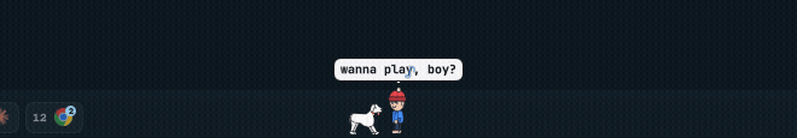
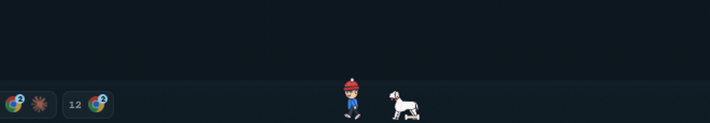

# Bar Buddies

Dash and his dog Biscuit live on your [Omarchy](https://omarchy.org) bar.





## What they do

- **Dodge you.** Bring the mouse near Dash and he runs. Corner him and he vaults over the cursor or vanishes in a puff and pops up somewhere else, even on another monitor. Catching him is a 1 in 1000 shot, and you get a trophy if you do.
- **Move your widgets.** Now and then Dash shoves a row of widgets along the bar, or ties a rope to one and drags it while Biscuit tugs behind him. Moved widgets still work, and they glide back home after about a minute.
- **Play fetch.** Dash throws a ball, bone or frisbee. Biscuit chases it, leaps for mid-air catches and brings it back.
- **Hang out.** They hop over and stand on widgets, play tag, dance when music is playing, and fall asleep late at night if you've been away.
- **Pet Biscuit.** Click him.

## Install

```sh
omarchy plugin add https://github.com/freematikk/bar-buddies.git --enable
```

Pick any bar section when asked. The widget itself takes no space; Dash and Biscuit roam the whole bar across all monitors.

Update later with `omarchy plugin update bar-buddies`, remove with `omarchy plugin remove bar-buddies`.

## Commands

```sh
omarchy-shell bar-buddies toggle     # hide / show them
omarchy-shell bar-buddies fetch      # play fetch now
omarchy-shell bar-buddies push       # push some widgets
omarchy-shell bar-buddies pull       # rope-pull a widget
omarchy-shell bar-buddies home       # send moved widgets home now
omarchy-shell bar-buddies dance
omarchy-shell bar-buddies poof       # Dash teleports
omarchy-shell bar-buddies stats
```

### Hooks for your own scripts

```sh
omarchy-shell bar-buddies cheer "Build"   # Dash cheers: "✓ Build done!"
omarchy-shell bar-buddies alert "CI"      # Dash waves: "! CI needs you"
omarchy-shell bar-buddies hide            # they step away (e.g. during a focus session)
omarchy-shell bar-buddies show
```

For example, end a long command with `; omarchy-shell bar-buddies cheer "Backup"`.

## Notes

- Needs Omarchy with the Quickshell-based shell, on Hyprland.
- Dash reads the cursor position from Hyprland's socket a few times a second (faster only when the mouse is near the bar), and the animation drops to 10 fps when they're resting.
- Catches and pets are saved in `~/.local/state/bar-buddies/state.json`.
- The characters are vector drawings built in `Sprites.js`; poses are just limb angles, so they're easy to tweak.

## License

MIT
